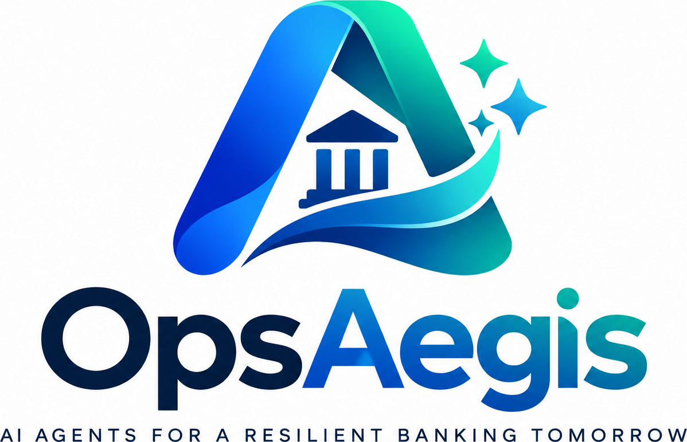

# OpsAegis Submission Video

A product-launch style video built from 10-second AI-generated clips that are merged into one continuous take. Each clip starts exactly where the previous one ends: same camera position, same cursor position and same screen state. Use the reference images with every clip so the UI stays consistent.

## Reference images

Upload these with each clip prompt.

| Image | Path | Use |
|---|---|---|
| Logo mark | [`public/logo-mark.png`](../public/logo-mark.png) | Opening logo reveal |
| Full logo | [`public/logo-full.png`](../public/logo-full.png) | Opening reveal and end card |
| Dashboard (Operations Overview, `/ops`) | [`docs/video/dashboard-ops.png`](video/dashboard-ops.png) | The screen the camera lands on |

> To add the dashboard screenshot: run `.\dev.ps1`, open `http://localhost:3000/ops` in a 1920×1080 browser window and capture the full window. Save it as `docs/video/dashboard-ops.png`.

## Global style (apply to every clip)

Cinematic product-launch film for a fintech AI platform, 16:9, 1920×1080, 24 fps. Clean, bright, premium look: soft white and light-slate studio background, subtle blue-to-teal gradient light matching the logo (royal blue #1D4ED8 to emerald teal #10B981). The UI is shown on a sleek borderless monitor or as a floating screen with soft depth-of-field and gentle reflections. Camera moves are smooth, slow and motivated (dolly, push-in, parallax), never shaky. On-screen UI must match the reference screenshot exactly: same layout, labels, colors and fonts; do not invent extra panels or change text. Sound design is crisp and realistic: soft mechanical keyboard typing, light mouse clicks, gentle UI whooshes on transitions, a low cinematic swell, and a modern ambient electronic music bed that keeps the same tempo (about 100 BPM) across all clips so the merged video plays as one continuous track. No voice-over and no added captions unless the clip asks for them.

## Clip 1 (0:00–0:10): Logo reveal to the live dashboard

The video opens on a clean, softly lit white void with a faint blue-to-teal glow in the center and slow-drifting light particles. A low cinematic bass swell rises as the OpsAegis "A" mark from the reference logo assembles: the blue ribbon sweeps in from the left, the teal ribbon curls in from the right, the bank-pillar icon rises into the center, and the three small sparkles twinkle on with tiny glassy chimes, each with a soft whoosh. At about two and a half seconds the wordmark "OpsAegis" types itself out letter by letter beneath the mark with crisp mechanical keyboard clicks, followed by the tagline "AI AGENTS FOR A RESILIENT BANKING TOMORROW", which fades in with wide letter spacing and a gentle shimmer sound. The logo holds for a beat while the music bed starts with a soft pulse.

At about four and a half seconds the camera pushes slowly toward the center of the "A". The logo dissolves into light and the push-through reveals a sleek monitor on a minimal desk in a bright, modern operations room, with a light whoosh as the camera passes through. The monitor shows the OpsAegis Operations Overview dashboard exactly as in the reference screenshot. On the left is the slim white sidebar with the OpsAegis logo at the top and the nine module icons. The header reads "Enterprise Banking Operations & Intelligence Platform" and has the search bar "Search across all 9 banking modules...", the "DEMO / MOCK DATA" badge and the persona selector. Below it is a row of KPI cards: Total Volume, Success / Failed, Active Incidents, Availability, Txn Speed and Pending Tasks. Under the cards are the Transaction Volume & AI Fraud Prediction chart, Cash Flow Analytics, Compliance Status Tracker, the Core Banking Health gauge, Critical Alerts & Incident Queue and Reconciliation Accuracy Trend.

As the camera settles, the dashboard comes alive. The KPI numbers count up with soft ticking sounds, the line charts draw themselves left to right with a faint electronic sweep, and the Core Banking Health gauge needle swings up and settles. A mouse cursor glides in from the bottom right with a subtle movement sound and comes to rest over the search bar with a light hover glow. The clip ends on a steady, slightly angled front view of the monitor filling about 80% of the frame, the dashboard fully loaded and still, and the cursor resting on the search bar.

**End frame (start the next clip from this):** a steady front view of the monitor at a slight angle showing the fully loaded Operations Overview dashboard, cursor hovering on the header search bar, music bed continuing at the same tempo.

## Clip log

| # | Time | Scene | Status |
|---|---|---|---|
| 1 | 0:00–0:10 | Logo reveal → Operations Overview dashboard | Prompt ready |
| 2 | 0:10–0:20 | Continues from the clip 1 end frame | To write |

## Merging tips

- Before generating the next clip, export the last frame of the current one and upload it as that clip's starting image.
- Make the cut on a movement (a cursor glide or camera push) and add a 4–6 frame crossfade so the joins don't show.
- If each clip generates its own music, lay one continuous music track over the whole edit and keep only the clicks, typing and whooshes from the clips.
